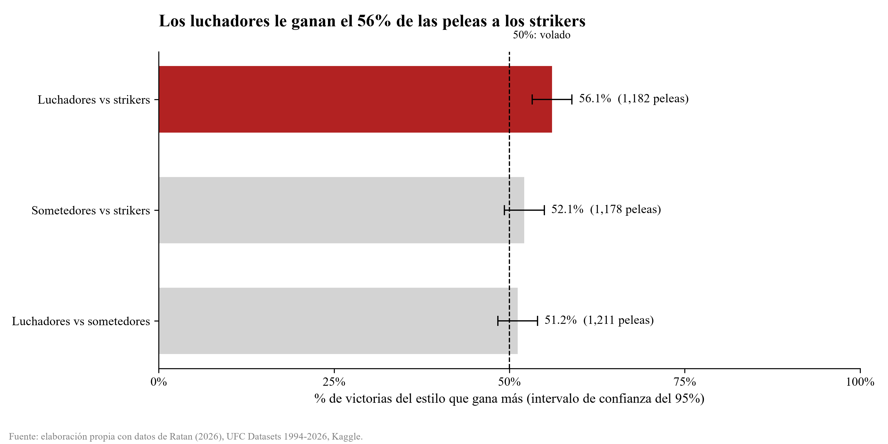
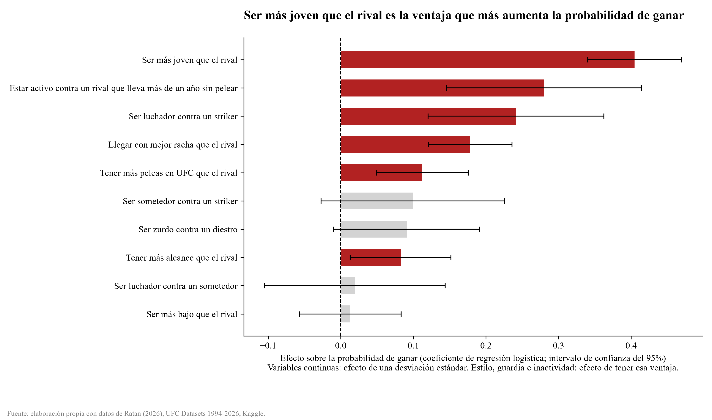

# ¿Qué hace ganar una pelea en UFC?

Análisis de datos de UFC (1994–2026) para responder tres preguntas:

1. **¿Existen estilos de pelea distinguibles a partir de las estadísticas?** Se clasifica a cada peleador como *striker*, *luchador* o *sometedor*.
2. **¿Qué estilo gana cuando se enfrentan estilos distintos?**
3. **¿Qué variables conocidas antes de la pelea pesan más en el resultado?** Se consideran edad, alcance, altura, experiencia, racha, inactividad, guardia y estilo.

## Resultados principales

- Salen tres estilos claros: **strikers** (muchos golpes por minuto), **luchadores** (muchos derribos) y **sometedores** (muchos intentos de sumisión).
- La única ventaja clara entre estilos es la de **luchador contra striker: 56.1%** de victorias (IC 95%: 53.3–58.9, 1,182 peleas). Sometedor contra striker (52.1%) y luchador contra sometedor (51.2%) no se distinguen de un volado.
- **Ser más joven que el rival es la variable que más pesa.** Le siguen llegar activo cuando el rival lleva más de un año sin pelear, ser luchador contra un striker, tener mejor racha, tener más peleas en UFC y tener más alcance. La ventaja del luchador sobre el striker se mantiene al controlar por todas las demás variables.
- En las peleas de 2022 en adelante, los modelos aciertan alrededor de **60%** de los resultados, contra 50% de un volado. Ayudan, pero el resultado de una pelea sigue siendo muy incierto.




## Métodos

| Etapa | Notebook | Métodos |
|---|---|---|
| Exploración | `analisis_ufc.ipynb` | Finalizaciones por método y round, bonos, derrotas por edad, victorias por altura |
| Estilos de pelea | `fighter_analisis.ipynb` | Transformación Yeo-Johnson, K-Means (k=3 elegido con el método del codo y Kneedle) sobre golpes por minuto, derribos y sumisiones cada 15 minutos |
| Estilo en el tiempo | `fighter_analisis.ipynb` | Tabla de una fila por peleador y pelea, construida solo con el historial **anterior** a cada pelea (sin fuga de información). El estilo se asigna con el modelo ya entrenado cuando hay al menos 15 minutos de historial |
| Enfrentamientos entre estilos | `fighter_analisis.ipynb` | % de victorias con intervalos de confianza del 95%, comparando por época |
| Importancia de variables | `importancia_variables.ipynb` | Regresión logística (statsmodels) con variables estandarizadas, comparando un modelo solo con estilo contra uno con todas las variables. También random forest con importancia por permutación, entrenando hasta 2021 y evaluando desde 2022 |

Decisiones de diseño:

- **No se usa la esquina roja o azul** para ordenar a los peleadores. Antes de 2005, el de la esquina roja gana el 99.9% de las veces en estos datos. Cada pelea se toma desde el punto de vista de un peleador elegido al azar con semilla fija, o en orden alfabético del estilo.
- Todas las variables se calculan como diferencia entre el peleador y su rival.
- El modelo de importancia usa peleas desde 2005 en las que ambos peleadores tienen estilo asignado.

## Datos

Ratan (2026), [*UFC Datasets 1994-2026*](https://www.kaggle.com/datasets/neelagiriaditya/ufc-datasets-1994-2025), Kaggle. El dataset es de dominio público. Archivos usados: `fighter.csv`, `fight.csv`, `event.csv`, `round.csv`, `master.csv` y `fighter_bonus.csv`.

`peleas_estilo.csv` se genera en `fighter_analisis.ipynb` y es la entrada de `importancia_variables.ipynb`.

## Cómo correrlo

Requiere Python 3.14 y [uv](https://docs.astral.sh/uv/).

```bash
uv sync
```

Abre los notebooks con el kernel del entorno `.venv`. Corre `fighter_analisis.ipynb` antes que `importancia_variables.ipynb`.

## Limitaciones

- Son asociaciones, no causas.
- No se incluyen lesiones, campamento, corte de peso, división ni la calidad de los rivales anteriores.
- El estilo requiere al menos 15 minutos de historial, así que los debutantes quedan fuera de los análisis por estilo.
- Algunas fechas de nacimiento en los datos originales tienen errores.
